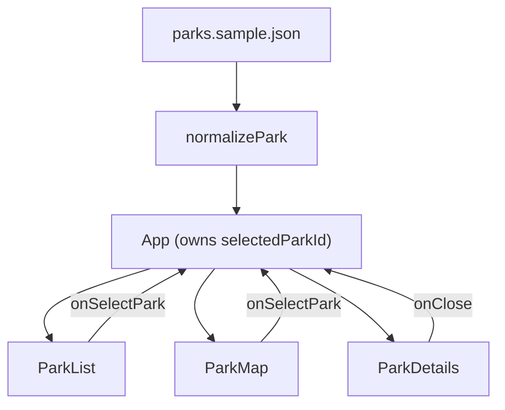

# AI Conversation Log — Grok Bot (Granicus Build)

Exported from the Granicus Build Grok Bot chat, oldest first. Visible user and bot messages only: hidden system prompts, background-task notices, reasoning, and tool calls are omitted. Wording of the kept messages is unedited.

---

**Tuesday, Nov 24, 2026, 2:40 PM CT**

**Grok Bot**

Hi Brian, I'm ready for the Granicus "Find a Park" take-home whenever you are. Once you send me the public repo URL, I'll read the brief and data and get the scaffold going.

---

**Tuesday, Nov 24, 2026, 2:54 PM CT**

**Brian**

Ok this is what we're working on today, we're to build a small parks app. Grok and Codex should both read the PDF and JSON first and i'll let you two decide on the tech-stack. Here is the public repo link https://github.com/Brian-Coding/granicus-find-a-park.git

Have codex initiate the project and then push the main branch to that repo. At the same time lets have yourself GrokBot and Codex collaborate on what the main components of this app will be. Once the main branch is ready, spin off a develop branch and then another branch from develop for each of the main features.

Once that is done spin up an instance of GPT 6.2 Astra high effort for each of these component branches and have them work in parallel. Once one of their jobs is done and the branch is PRd against develop, it should flag you GrokBot to review the PR and request any revisions.

If you GrokBot and Codex disagree then discuss the matter, elevate to me any UX based product decisions, otherwise the two of you can come to agreements on architecture. Remember this is a small app, do not over engineer it. Keep additional features like search or filter for after core work has been finished and proven.

While that work is going, lets me and you Grok talk through the app and what potential slip ups, missing data, traps, or oversights might be common on a task like this.

Finally, start a 90min timer, we aren't to spend more than 2 hours on this and I would like to spend the last 30min testing, polishing, and studying the architectural decisions. sending this at 2:54pm

---

**Tuesday, Nov 24, 2026, 2:54 PM CT**

**Grok Bot**

On it. I'm reading the brief and the park data now, then I'll start Codex on the scaffold and set the 90-minute timer (ends at 4:24 PM CT).

---

**Tuesday, Nov 24, 2026, 2:54 PM CT**

**Grok Bot**

Codex is scaffolding now: Vite, React, TypeScript, Leaflet with OpenStreetMap tiles (no API key needed), and Vitest for tests. I'm checking that the "GPT 6.2 Astra" model name works in Codex, and every Codex run is saved to a log folder since the brief wants full unredacted transcripts. The timer will ping here at 4:24 PM CT (90 minutes) and again at the 4:54 PM CT hard stop.

My proposed split is three branches: map, list, and details. The data cleanup code, the shared types, and the selected-park state go into the scaffold itself so the three branches don't collide. Codex will weigh in, and I'll flag anything we disagree on.

---

**Tuesday, Nov 24, 2026, 2:54 PM CT**

**Grok Bot**

Here are the traps I found in the data and the brief, to talk through while it builds:

1. **Placeholder images.** Every image URL points at `images.example.com`, so none of them will load. We need a fallback for broken images, and Cedar Hill and East Ridge have no images at all.
2. **Missing or null fields.** Highland Dog Park has no address, Old Mill's description is `null`, and Cedar Hill's rating is `null`. The trap is showing "undefined", "null", or a made-up value. My take is to hide a field that's missing, or say "Not provided" for the fields residents expect, like address and hours.
3. **Suspicious coordinates.** Cedar Hill sits at exactly 40.7128, -74.006, which is the textbook coordinate for downtown Manhattan, not a nature preserve. We shouldn't "fix" it, but it's worth listing under known issues in the README.
4. **Hours are free text.** Values like "Dawn to dusk" and "24 hours" mean an "Open now" badge would require guessing, so we show the hours exactly as given.
5. **Amenity slugs.** Values like `dog-run` need to be turned into readable labels like "Dog run".
6. **Accessibility details graders check.** The map markers aren't reachable by keyboard in a useful way, which is exactly why the list has to be a full alternative. Focus should move to the details panel when you pick a park, and the focus ring must actually be visible (watch for a CSS reset that removes `outline`).
7. **Leaflet in Vite.** The default marker icons break in Vite builds unless you import the images explicitly. It's a classic bug.
8. **No location access.** We never ask for the user's location, so there's no permission prompt to handle. The map just fits to the parks on load.

One product question for you: should the municipality stay NYC as the data implies, or do you want a fictional city name in the header?

---

**Tuesday, Nov 24, 2026, 3:02 PM CT**

**Grok Bot**

The scaffold is on [granicus-find-a-park](https://github.com/Brian-Coding/granicus-find-a-park) and passes typecheck, lint, the 18 tests, and the build. `develop` and the `feature/map`, `feature/list`, and `feature/details` branches are pushed. Codex agreed with the three-branch split, so there was no architecture dispute. Three Codex sessions are now running in parallel, each on GPT 6.2 Astra at high effort in its own folder. Each will open a PR against `develop`, and I'll review every one before anything merges.

---

**Tuesday, Nov 24, 2026, 3:02 PM CT**

**Grok Bot**

Codex raised two UX questions that are yours to decide. I gave the details session sensible defaults so it isn't blocked, and either one is a quick change:

1. **Missing fields.** Right now address and hours always show, with "Not provided" when they're empty, because residents expect them. The optional fields (description, rating, acreage, photos) are hidden when empty.
2. **Back on mobile.** "Back to list" returns you to the list and puts keyboard focus back on the park you had open.

The municipality question from earlier is still open too. It can stay NYC as the data implies, or we can use a fictional city name.

---

**Tuesday, Nov 24, 2026, 3:11 PM CT**

**Brian**

1 - yes let's place a fallback image of a park for broken images, Codex can generate a generic park image for that
2 - let's say not provided or not found, so that the user sees a consistent spread of information fields from one park to another, hiding them causes incongruity 
3 - yes certainly list it, while we're doing this the coordinate data of these parks should be trivial to find, find it and place that data into the app for potential later "fix"
4 - Yes, certainly always show hours as given, users hate ambiguity in availability times, let's also make sure this information is front and center users shouldn't have to look for it
5 - yes property format
6 - do it, well do manual testing for UX once it is setup
7 - then import them explicitly 
8 - good

Yes let's keep it as NYC for now

---

**Tuesday, Nov 24, 2026, 3:11 PM CT**

**Grok Bot**

Got it, NYC stays. The details panel is already merged into `develop`. I'm sending Codex a follow-up on details with your changes: a generated generic park image as the fallback, every field always shown with "Not provided", and hours moved to the top. Separately, I'm looking up real coordinates for the parks.

---

**Tuesday, Nov 24, 2026, 3:11 PM CT**

**Brian**

5 - I meant properly* format

---

**Tuesday, Nov 24, 2026, 3:11 PM CT**

**Grok Bot**

I reviewed the first details PR before merging it ([PR #2](https://github.com/Brian-Coding/granicus-find-a-park/pull/2)) and left the review notes on GitHub. It had no invented data, a rating of 0 was handled correctly, and it didn't steal focus on page load. Your changes are now going into a second details round on its own branch.

Two notes on that round. Codex can't generate photos, so the fallback will be a simple park illustration it draws as an SVG file. Its alt text and a small caption will say it's a placeholder, so it can never pass for a real photo of the park. On the coordinates, I expect only some parks are real. Prospect Park is real, while names like Riverside Commons and East Ridge Trailhead look made up. The lookup will mark those "no real match" instead of guessing, and the results go in a separate reference file the app doesn't use yet. The map and list sessions are still running.

---

**Tuesday, Nov 24, 2026, 3:12 PM CT**

**Grok Bot**

The map is reviewed and merged into `develop` ([PR #1](https://github.com/Brian-Coding/granicus-find-a-park/pull/1)). The Leaflet marker icons are imported explicitly as you asked, there's no location prompt, and the map fits itself to the parks on load. Clicking a marker or the "View details" button in its popup selects the park, and the selected marker is drawn larger and in a different color, so it isn't signaled by color alone.

I left review notes on GitHub. Three things go on the test list: if the map tiles fail to load you only see grey squares with no message, the map needs a check in dev mode, and screen-reader labeling of the map needs a pass. Still waiting on the list PR and the second details round.

---

**Tuesday, Nov 24, 2026, 3:13 PM CT**

**Grok Bot**

The list PR is in, and I sent it back for changes ([PR #3](https://github.com/Brian-Coding/granicus-find-a-park/pull/3)). The component itself is good: real buttons inside a proper list, sorted by name, and no "undefined" when an address is missing. My main catch is that its "keyboard" test is fake. It focuses and clicks the button directly, so it would still pass if keyboard support broke. Codex is replacing it with a real Tab, Enter, and Space test, adding focus return to the list when details close, adding an explicit focus ring, and fixing a small layout shift on the selected item. That fake test is a good example to show Granicus of a problem that passing tests can miss.

One UX call for you: when a park has no address, its list item shows only the name. Do you want the list to show "Address not provided" too, for consistency, or maybe show each park's hours there since you want hours front and center?

---

**Tuesday, Nov 24, 2026, 3:15 PM CT**

**Brian**

Hmmm strange, Codex has no issue generating images in the past. But we won't dwell on that right now.

Yes - Address not Provided 

Good job finding the broken test

---

**Tuesday, Nov 24, 2026, 3:15 PM CT**

**Grok Bot**

Fair point on the images. I assumed Codex couldn't generate them without checking, and I shouldn't have. I'll have the details session try a real generated park image first and keep the SVG only if that fails. "Address not provided" is going into the list revision now.

---

**Tuesday, Nov 24, 2026, 3:15 PM CT**

**Grok Bot**

While those run, here's what I'd look at in the 30-minute test pass. Most of these are checks that unit tests can't do:

1. **Keyboard only.** Unplug the mouse. Tab through the list, press Enter on a park, and confirm focus jumps to the details heading. Then press "Back to list" and confirm focus returns to the same park. Watch whether focus gets trapped inside the map, since Leaflet makes its container and markers focusable.
2. **Phone width.** Use dev tools at 375px. Check that a long name like "Cedar Hill Nature Preserve" wraps, and that after picking a park on a phone you can actually see the details without hunting for them.
3. **Map and list stay in sync.** Pick a park from the list and the map should pan to it and highlight its marker. Click a marker and the list should highlight that park.
4. **Map tiles offline.** Block `tile.openstreetmap.org` in dev tools. The list and details should still work.
5. **Zoom to 200%.** This is a common accessibility check, and layouts often break at that size.

For the follow-up interview, the fake keyboard test is your strongest "here's a mistake I caught" story. The decision to use native buttons instead of a custom ARIA listbox is a good architecture point to explain.

---

**Tuesday, Nov 24, 2026, 3:16 PM CT**

**Brian**

Talk to me about the accessibility part

---

**Tuesday, Nov 24, 2026, 3:16 PM CT**

**Grok Bot**

The brief sets a specific bar: a resident has to be able to find a park, select it from the list, and open its details using only a keyboard, with a visible focus indicator, and the list and details have to work as an alternative to the map. Here's how we're meeting that and where the traps are.

**The map is the hard part, so the list does the heavy lifting.** Leaflet markers can technically be tabbed to, but a dozen pins in an order nobody chose is a poor experience, and screen readers get little out of a map. So we treat the map as a visual extra. The list is the main way in, and everything the map can do, the list can do too.

**Native buttons instead of custom ARIA.** Each park in the list is a real `<button>` inside a `<ul>`, so Tab, Enter, and Space work for free and screen readers announce "button, Prospect Park". The common mistake is building a fancy `role="listbox"`, which then requires hand-coding arrow-key behavior, and that usually gets left half done. If they ask why we skipped it, the answer is that the simpler choice is also the more accessible one.

**Focus management is where most apps quietly fail.** When you pick a park, focus moves to the details heading, so a screen-reader user hears the park name instead of being left on the list wondering whether anything happened. "Back to list" returns focus to the park you came from. We also made sure focus doesn't jump on page load, because stealing focus before the user does anything is its own bug.

**Visible focus ring.** It's a 3px high-contrast outline with an offset, using `:focus-visible` so it shows for keyboard users and not on mouse clicks. The classic trap is a CSS reset with `outline: none`, which is why the list now has its own rule instead of relying only on the global one.

**Selected state that isn't color-only.** The selected list item gets a thick left border plus a background tint and `aria-current`, so it's announced to screen readers and visible to color-blind users. The selected map marker is also larger, not just recolored.

**Honest content.** Missing fields say "Not provided" rather than going blank, so screen-reader users hear the same fields in the same order for every park. Placeholder images get alt text that says they're placeholders. Describing a stock illustration as "Photo of Prospect Park" would be inventing data.

**Readable and touch-friendly.** Buttons are at least 44px tall, which is the standard minimum touch target, and long names wrap instead of overflowing.

What we're not doing is a full WCAG audit or real screen-reader testing, and that belongs in the README as a known gap. A quick pass with NVDA (a free Windows screen reader) or Windows Narrator during testing would let you say in the interview that you checked it, not just that you wrote code for it.

---

**Tuesday, Nov 24, 2026, 3:19 PM CT**

**Brian**

Ok this sounds good, the keyboard only usage will be a priority test.

Talk me through the architecture

---

**Tuesday, Nov 24, 2026, 3:19 PM CT**

**Grok Bot**

It's deliberately flat: one page, no backend, no router, no state library.

**Data layer.** The JSON is bundled at build time and goes through `normalizePark` once. That function is the single place that deals with messy data. It trims strings, turns `null` and empty strings into "missing", makes `amenities` and `images` always arrays, and drops coordinates that aren't valid numbers in range. Everything downstream can trust the shape, so no component is full of `?.` checks and `if (x !== null)`. It's also the easiest code to unit test, and it has the most tests.

**State.** There's one piece of state, `selectedParkId`, and it lives in `App`. The map and list both report a selection upward, and `App` passes the selected park down to the details panel. That's why map and list stay in sync for free: they read the same value. Storing the ID rather than a copy of the park object avoids stale data. With three components and one value, React Context or Redux would be over-engineering.

**Components.** Each one is a folder holding its component, its CSS, and its tests. That's also what let three Codex sessions work in parallel without merge conflicts: each owned a folder, and the shared contract (the `Park` type and the props) was set in the scaffold first. That's a nice point for the "how did you direct the AI" question. You designed the seams before splitting the work.

**Map specifics.** Leaflet with OpenStreetMap tiles means no API key and nothing for a reviewer to configure. The marker filter lives in a small pure function (`parksWithCoordinates`) so it can be tested without rendering a map, since Leaflet doesn't run well in a test environment.

**Styling.** Plain CSS per component plus one global file for layout and the focus ring. Two panes on desktop, stacked on phones.

**What it would take to grow.** Swapping the JSON import for a `fetch` from a real API means adding loading and error states in `App`, while normalization stays the same. Search and filters would be a derived list in `App` (filtered parks) passed to both map and list, so the single-state design already supports them. If it got bigger, the next step would be putting the selected park in the URL (`?park=prospect-park`) so residents can share links, and that's a strong "next steps" item for the README.

The trade-off to own is that bundling the data means updating parks requires a rebuild. That's fine for a demo, and it's the first thing to change before public use.

---

**Tuesday, Nov 24, 2026, 3:19 PM CT**

**Grok Bot**

The list is merged into `develop` after its revision round ([PR #3](https://github.com/Brian-Coding/granicus-find-a-park/pull/3)). It now has real keyboard tests, focus returns to the park when details close, there's an explicit focus ring, and missing addresses show "Address not provided". All 54 tests pass and the build is clean.

I caught one more small thing myself: the Windows tooling had added invisible byte-order marks to four files, so I stripped them before merging. Map and list are done. The second details round and the coordinates lookup are still running.

---

**Tuesday, Nov 24, 2026, 3:20 PM CT**

**Grok Bot**

All three features are merged into `develop` ([PR #4](https://github.com/Brian-Coding/granicus-find-a-park/pull/4) was the last). Lint, typecheck, and the build pass, and the test count is now 71. Codex generated the fallback image itself, so you were right: it's a painted park scene with a path and trees, and its caption and alt text say it's a placeholder.

The app is running on your PC at [localhost:5173](http://localhost:5173/), so you can start the keyboard-only test whenever you're ready. You'll notice one thing right away: all the sample image URLs fail, so Prospect Park shows two identical placeholder images. Do you want those collapsed into one?

Next on my side are the coordinates PR, which is still running, and a draft README. It's 3:21 PM CT, so we're well ahead of the 4:24 PM mark.

---

**Tuesday, Nov 24, 2026, 3:21 PM CT**

**Grok Bot**

The coordinates research is merged ([PR #5](https://github.com/Brian-Coding/granicus-find-a-park/pull/5)) as a reference file that the app doesn't use yet. You were half right that they'd be easy to find. Only Prospect Park is a real park whose location checks out, and it's about 230 m off. Riverside Commons and Sunset Playground have made-up names, but their addresses roughly match Riverside Park and Sunset Park Playground.

The other nine have no real match, and several pins land in odd places. Cedar Hill is the generic City Hall point, Hillcrest Skate Park sits on the Brooklyn Bridge Marriott, and East Ridge Trailhead is on a residential block in the Bronx. So the sample data is mostly fictional with NYC-ish coordinates. That's a solid README point: we kept the supplied data as-is and documented the problem rather than quietly "fixing" it with guesses.

---

**Tuesday, Nov 24, 2026, 3:21 PM CT**

**Grok Bot**

The browser test is running on my computer now against a build of `develop`, and it'll take about 15 minutes. One clarification: Codex is installed on your PC, not on my computer, so the hands-on testing in my browser is done by my own browser tester rather than by Codex. This first pass covers a keyboard-only run (recording the exact Tab order and whether focus ever gets stuck in the map), clicking markers and the list, the four parks with missing data, 200% zoom, and a review of readability and layout from the screenshots. A phone-width pass comes next.

Meanwhile, Codex is collapsing the duplicate placeholders and drafting the README in its own branch, so your localhost server isn't touched.

---

**Tuesday, Nov 24, 2026, 3:31 PM CT**

**Brian**

Let's get a concise order of operations that will cover testing all usability

---

**Tuesday, Nov 24, 2026, 3:31 PM CT**

**Grok Bot**

Here's a test order that covers every usability requirement. Each step builds on the one before it.

1. **Cold load, desktop.** The app loads without asking for your location, shows the map and list, and nothing in the details panel looks broken before you pick a park.
2. **Keyboard only, no mouse.**
   - Tab from the top and note every place focus stops.
   - Check that the focus ring is visible at each stop and that focus never gets stuck in the map.
   - Press Enter on a park in the list. Focus should land on the details heading.
   - Use Back. Focus should return to the same park in the list.
   - Repeat the selection with Space.
3. **Mouse.**
   - Clicking a marker should open its popup, and "View details" should open that park's details and highlight it in the list.
   - Clicking a park in the list should move the map to it and highlight its marker.
4. **Messy data.**
   - Highland Dog Park has no address.
   - Old Mill has no description.
   - Cedar Hill has no images, no rating, and the suspect coordinates.
   - Prospect Park's photo links are broken.
   - In each case, check that missing fields say "Not provided", that only one placeholder image shows with a clear label, and that nothing reads "undefined", "null" or "NaN".
5. **Readability.**
   - Hours should be the first thing you see in the details.
   - Text size and contrast should be comfortable.
   - The selected state should be obvious in both the list and the map.
6. **Phone width, around 375px** (in DevTools, use the device toolbar).
   - The map and list should stack without sideways scrolling.
   - Tap targets should be big enough.
   - Details should be reachable and easy to close.
7. **200% zoom on desktop.** Nothing should overlap, get cut off, or need sideways scrolling.
8. **Failure cases.**
   - Go offline after the page loads. Map tiles will go grey, which is a known issue, but the list and details should still work.
   - Refresh with nothing selected.
9. **Automated checks.** Run `npm test`, `npm run lint` and `npm run build`. All three should be clean.

My browser tester is running steps 1 through 5 and 7 right now. I'll run step 6 after it, and steps 8 and 9 once the README and placeholder fix are merged. That leaves you free to focus on how it feels to use with the keyboard and on a phone.

---

**Tuesday, Nov 24, 2026, 3:32 PM CT**

**Grok Bot**

The first browser test passed every core check: keyboard-only, the map and list staying in sync, the parks with missing data, and 200% zoom. There's no keyboard trap, no "undefined" or "null" anywhere, and Enter and Space both select a park. Focus goes to the details heading and Back returns it to the right list item. It also found real problems:

1. **Details are below the fold on desktop.** They render under all 12 list items while a big empty area sits under the map (screenshot below). Someone using a mouse has to scroll about 10 wheel clicks to see what they just clicked. This is the biggest usability problem.
2. **A stale popup stays open on the map.** If you pick a park from the list, the previous park's popup stays open. That's a bug, and I'll fix it.
3. **The marker focus ring is weak.** The list, heading and buttons have strong rings, but the map markers barely show one. I'll fix this too.
4. **Duplicate placeholder photos and a caption that's too small.** The Codex fix that's already running covers these.
5. **Minor.** A keyboard user passes 25 stops before reaching the zoom controls (12 list items, then 12 markers). Back also clears the selection. Both are acceptable, and I'll list them as known issues rather than change them.

The phone-width test is running now.
[Image: Desktop: details pushed below the list, empty space under the map, stale Central Plaza popup while Lakeshore Point is selected]

---

**Tuesday, Nov 24, 2026, 3:32 PM CT**

**Grok Bot**

Question card: "Where should park details go on desktop?"
Options: Right column, under the map / Three columns: list, map, details / Leave it, list as known issue (custom answer allowed)

---

**Tuesday, Nov 24, 2026, 3:34 PM CT**

**Grok Bot**

The phone-width test at 375px also passed the basics: there's no sideways scrolling, text is readable, images scale, and the map doesn't trap page scrolling. It found more of the same layout problem:

- **Details sit below all 12 list items, with the map below the details.** Tapping a park doesn't scroll to its details, so on a phone it can look like nothing happened.
- **The stale popup bug shows up here too.** The map can still show the previous park's popup.
- **Some tap targets are too small.** The popup's "View details" button is about 34px tall, the zoom buttons about 37px, and the popup's close button about 20px. The usual minimum is 44px.

Once you pick the desktop layout above, I'll start one Codex session for all of these fixes:
- the layout itself
- scrolling to the details when a park is picked on a phone
- closing the stale popup when the selection changes
- a stronger focus ring on map markers
- a bigger "View details" button

Leaflet's own zoom and close buttons will go in the README as known issues.

---

**Tuesday, Nov 24, 2026, 3:35 PM CT**

**Grok Bot**

I reviewed and merged [PR #6](https://github.com/Brian-Coding/granicus-find-a-park/pull/6):
- Broken photos are now hidden.
- A park whose photos all fail, or that has none, shows exactly one illustration with a visible "Placeholder" badge.
- The README is rewritten.

Codex reported that all 73 tests, lint, typecheck and build pass. I read the diff and the tests cover the important cases. I also updated your local `develop` folder, so your localhost tab should pick up the change on its own, without restarting the server. The README still has blanks for the browser test results and total time, and I'll fill those after the layout fixes. The layout question above is the only thing I'm waiting on.

---

**Tuesday, Nov 24, 2026, 3:49 PM CT**

**Brian**

Answered: Put details in the right column under the map

---

**Tuesday, Nov 24, 2026, 3:49 PM CT**

**Grok Bot**

Got it, details will go in the right column under the map. I'm starting a Codex session for the layout and the other fixes now.

---

**Tuesday, Nov 24, 2026, 3:49 PM CT**

**Grok Bot**

Codex is working on its own branch now, which leaves your localhost server alone. It'll move the details panel into the right column and make sure a phone tap scrolls to the details. It'll also close the stale popup, add a clear focus ring to markers, and make the popup button bigger. When the PR is up, I'll review it, merge it, and run the browser tests again. That should land before the 4:24 PM CT testing mark.

---

**Tuesday, Nov 24, 2026, 3:49 PM CT**

**Brian**

Supply any other UX decisions to me with an image and choices

---

**Tuesday, Nov 24, 2026, 3:49 PM CT**

**Grok Bot**

Will do. From now on, every UX decision will come to you with a screenshot and a set of choices.

---

**Tuesday, Nov 24, 2026, 3:49 PM CT**

**Grok Bot**

One open UX call is what "Back to list" should do. Right now it clears the selection: the details reset to "No park selected" and the marker goes back to blue, as in the screenshot, while focus returns to the park you had selected. With details moving next to the map on desktop, the list will always be visible there, so "Back to list" mostly matters on a phone.
[Image: After Back to list: Prospect Park is focused in the list, the details read No park selected, and every marker is blue]

---

**Tuesday, Nov 24, 2026, 3:49 PM CT**

**Grok Bot**

Question card: "What should "Back to list" do?"
Options: Keep the park selected, just jump back to the list / Rename it "Close" and keep clearing / Leave as is (custom answer allowed)

---

**Tuesday, Nov 24, 2026, 3:50 PM CT**

**Brian**

Answered: Back should keep the park selected and just return focus to the list

---

**Tuesday, Nov 24, 2026, 3:50 PM CT**

**Grok Bot**

Got it. "Back to list" will keep the park selected and just move you back to the list. I'm adding that to the Codex session that's already running.

---

**Tuesday, Nov 24, 2026, 3:50 PM CT**

**Grok Bot**

Codex has the change and will put it in the same PR. I'll review that PR before I merge it.

---

**Tuesday, Nov 24, 2026, 3:59 PM CT**

**Grok Bot**

I reviewed [PR #7](https://github.com/Brian-Coding/granicus-find-a-park/pull/7) and asked for one change before merging. The other fixes are right. Back keeps the park selected, the stale popup now closes, markers have a visible focus ring, and the popup button is 44px. All 74 tests pass.

The problem is how Codex got the map to sit above the details. It reversed their order with CSS, so Tab now moves in a different order from what you see on screen. Pressing Tab from the details jumps back up into the map, which fails the WCAG rule that focus order has to follow the visual layout. The fix is to put list, map, details in the code in the same order they appear. That fixes desktop. On a phone the order becomes list, map, details, and picking a park already scrolls you to its details. The revision is running now.

---

**Tuesday, Nov 24, 2026, 4:01 PM CT**

**Brian**

Ok my manual testing looks good, the keyboard control is all working properly

---

**Tuesday, Nov 24, 2026, 4:01 PM CT**

**Grok Bot**

Great, that matches what my browser test found. Your localhost is still running the version from before PR #7, so once the revision is merged I'll update your folder, and a quick Tab pass will confirm the new layout and the Back behavior. I'll also put your manual keyboard check in the README's "How it was checked" section.

---

**Tuesday, Nov 24, 2026, 4:02 PM CT**

**Grok Bot**

I merged [PR #7](https://github.com/Brian-Coding/granicus-find-a-park/pull/7) once the revision was in. Tab order now matches what's on screen, and Codex confirmed the marker ring had been clipped at the map's edge, so it now draws inside the icon. Your localhost folder is updated, so refresh it. You'll see details under the map, Back keeping the park selected, and a single placeholder with its badge. My browser tester is running a regression pass on the new build now.

---

**Tuesday, Nov 24, 2026, 4:05 PM CT**

**Grok Bot**

The regression pass on the new build came back clean on everything I fixed:
- Details now sit under the map.
- Tab order matches what's on screen.
- Back keeps the park selected.
- The stale popup closes.
- The marker ring is visible and not clipped.
- The "View details" button measures 44px.
- Each park shows a single placeholder with its badge.

I traced two things it flagged myself. The two console errors are the sample data's broken photo links at `images.example.com`, which is expected and handled. The empty Tab stop after "Back to list" is focus leaving the page into the browser bar, because details are now the last thing on the page.

That leaves one UX call. On a phone, tapping a park scrolls only until the park name appears at the very bottom of the screen, so the hours sit just below the fold.
[Image: Phone at 375px after tapping Prospect Park: the map fills the screen and the Prospect Park heading peeks in at the bottom edge]

---

**Tuesday, Nov 24, 2026, 4:05 PM CT**

**Grok Bot**

Question card: "On phone, where should the screen land after tapping a park?"
Options: Details at the top of the screen (hours visible) / Leave as is, note it as a known issue (custom answer allowed)

---

**Tuesday, Nov 24, 2026, 4:07 PM CT**

**Brian**

Answered: On phone, scroll so the details start at the top of the screen

---

**Tuesday, Nov 24, 2026, 4:07 PM CT**

**Grok Bot**

Got it. On a phone, tapping a park will put the details at the top of the screen so the hours show right away. I'm having Codex make the change now. It's small, and desktop won't change.

---

**Tuesday, Nov 24, 2026, 4:07 PM CT**

**Grok Bot**

While that runs, I'll start filling in the README's test results. The testing window starts at 4:24 PM CT.

---

**Tuesday, Nov 24, 2026, 4:09 PM CT**

**Brian**

Ok lets wrap this up

Once regression test is passed, put its results into the README and fix anything real bugs it found.

1 - Fill in time spent, start was just before 3pm and it is just after 4pm so lets call it about 70 minutes.
2 - change the AI usage line so the logs live in the ai-logs/ folder in the repo not outside of it
3 - run the tests, lint, typecheck and build one last time on develop
4 - generally I would merge develop into main myself manually but for this simple app demonstration I will let you do it, once the above is done, merge develop into main and push
5 - tell me when main is final, give me the exact end time.

Dont send anything, I will send both the repo link as well as the zipped source where it needs to go

---

**Tuesday, Nov 24, 2026, 4:09 PM CT**

**Grok Bot**

Wrapping up now. Once the phone-scroll fix merges, I'll fill in the README with the test results, the 70 minutes, and the `ai-logs/` folder in the repo. Then I'll run tests, lint, typecheck and build on `develop`, merge it into `main`, and give you the exact end time. I won't send anything to anyone.

---

**Tuesday, Nov 24, 2026, 4:09 PM CT**

**Grok Bot**

Before I commit the logs into the repo's `ai-logs/` folder, I'll scan them for tokens or keys, since they'll be public.

---

**Tuesday, Nov 24, 2026, 4:10 PM CT**

**Grok Bot**

I verified and merged [PR #8](https://github.com/Brian-Coding/granicus-find-a-park/pull/8), the phone-scroll fix. At 375px, the park name now lands at the top of the screen with the hours right below it. The final pass is running now: the README update, copying the logs into the repo with a secret scan, the last round of checks, and the merge of `develop` into `main`.

One thing only you can do: this chat with me is part of the AI logs, so export it from the app yourself and add it to the zip. The README will say it's included separately.

---

**Tuesday, Nov 24, 2026, 4:17 PM CT**

**Grok Bot**

`main` is final. It's at commit `35c41ca`, pushed at 4:16:42 PM CT, and its contents match `develop` exactly. The end time is 4:16:42 PM CT.

- **Final checks on `develop`:** typecheck, lint, all 75 tests, and build passed.
- **README:** it has the test results, the 70 minutes, and the logs location. All Codex logs and prompts are now in `ai-logs/` in the repo, indexed by `ai-logs/README.md`. The secret scan of those files came back clean.
- **Merged PRs:** the README and log changes went in through [PR #9](https://github.com/Brian-Coding/granicus-find-a-park/pull/9), which I merged into `develop` before merging `develop` into `main`.

The README says the work finished about 4:10, but the real end was 4:16, about 77 minutes. You might want to adjust that line before zipping, and remember to export this chat for the zip.

I paused the build timer so it won't ping you; you can remove it from your routine list. Nothing has been sent anywhere.
